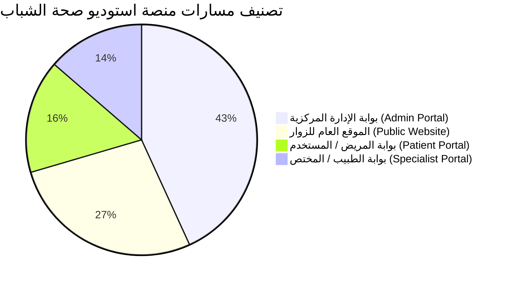

# خريطة مسارات وصفحات المنصة الكاملة (Website Route Map & Inventory)
## استوديو صحة الشباب | Youth Health Studio Telemedicine Platform
**تاريخ التوثيق:** 15 أكتوبر 2026  
**إجمالي المسارات المكتشفة:** 44 صفحة ويب حقيقية  
**التقنية المعتمدة:** Vanilla HTML5 / Modern CSS / Vanilla JS (ES Modules) / Supabase Client CDN  
**الاتجاه والتجاوب:** جميع الصفحات تدعم الاتجاه العربي RTL (`dir="rtl"`) ومتجاوبة بالكامل مع الأجهزة الذكية والأجهزة اللوحية والمكتبية.

---

## 1. ملخص تصنيف المسارات

---

## 2. الموقع العام وبوابة الزوار (Public Website - 12 صفحة)

| المسار والملف | عنوان الصفحة | نوع الصفحة | الصلاحية المطلوبة | المصادقة | الغرض من الصفحة | الإجراءات والأزرار الرئيسية | الجداول والخدمات المرتبطة | الحالة الفنية | التجاوب مع الجوال |
|---|---|---|---|---|---|---|---|---|---|
| [/index.html](file:///c:/Users/abdelilah/Desktop/studio%20project/index.html) | استوديو صحة الشباب | عامة (Public) | عام للجميع | غير مطلوبة | الصفحة الرئيسية للمنصة، التعريف بالخدمات، إحصائيات الولايات، وآخر الفعاليات والمقالات. | طلب استشارة، حجز موعد، تبديل المظهر، تصفح الأقسام | `campaigns`, `articles`, `events`, `wilayas_stats` | **يعمل (Working)** | متجاوب 100% |
| [/about.html](file:///c:/Users/abdelilah/Desktop/studio%20project/about.html) | من نحن - استوديو صحة الشباب | عامة (Public) | عام للجميع | غير مطلوبة | التعريف برسالة المنصة، الرؤية الصحية، والشركاء والمشرفين الصحيين. | التنقل للرئيسية، استعراض الشركاء | `pages_content`, `site_settings` | **يعمل (Working)** | متجاوب 100% |
| [/articles.html](file:///c:/Users/abdelilah/Desktop/studio%20project/articles.html) | المقالات - استوديو صحة الشباب | عامة (Public) | عام للجميع | غير مطلوبة | مكتبة المقالات التوعوية والتثقيف الصحي للشباب حسب التصنيفات. | بحث، تصفية حسب التصنيف، فتح المقال | `articles` | **يعمل (Working)** | متجاوب 100% |
| [/article.html](file:///c:/Users/abdelilah/Desktop/studio%20project/article.html) | المقال - استوديو صحة الشباب | عامة (Public) | عام للجميع | غير مطلوبة | قراءة المقال التوعوي الكامل، اسم الطبيب الكاتب، والمقالات ذات الصلة. | مشاركة المقال، العودة للمقالات | `articles`, `profiles` | **يعمل (Working)** | متجاوب 100% |
| [/events.html](file:///c:/Users/abdelilah/Desktop/studio%20project/events.html) | الفعاليات الوطنية والتوعوية | عامة (Public) | عام للجميع | غير مطلوبة | استعراض الحملات والملتقيات الوطنية والأنشطة الشبابية الميدانية. | فلترة حسب التاريخ والولاية، حجز التذكرة | `events`, `event_registrations` | **يعمل (Working)** | متجاوب 100% |
| [/event_details.html](file:///c:/Users/abdelilah/Desktop/studio%20project/event_details.html) | تفاصيل الفعالية | عامة (Public) | عام للجميع | غير مطلوبة | عرض جدول أعمال الفعالية، الموقع الجغرافي، والتسجيل والحصول على تذكرة حضور. | تأكيد الحجز، تحميل التذكرة QR | `events`, `event_registrations` | **يعمل (Working)** | متجاوب 100% |
| [/doctor_profile.html](file:///c:/Users/abdelilah/Desktop/studio%20project/doctor_profile.html) | الملف المهني للطبيب | عامة (Public) | عام للجميع | غير مطلوبة | الصفحة العامة لتعريف المريض بخبرات الطبيب، تقييماته، ومواعيده المتاحة. | طلب استشارة مع هذا الطبيب، حجز موعد | `profiles`, `specialist_profiles`, `reviews` | **يعمل (Working)** | متجاوب 100% |
| [/ai_assistant.html](file:///c:/Users/abdelilah/Desktop/studio%20project/ai_assistant.html) | المساعد التوعوي الذكي (YHS AI) | عامة (Public) | عام للجميع | غير مطلوبة | روبوت توعوي يقدم معلومات وإرشادات صحية أولية مدعومة بنماذج الذكاء الاصطناعي. | كتابة استفسار، الحصول على إرشادات أولية | `ai_conversations`, `ai_messages` | **يعمل (Working)** | متجاوب 100% |
| [/verify.html](file:///c:/Users/abdelilah/Desktop/studio%20project/verify.html) | التحقق من صحة المستندات والشهادات | عامة (Public) | عام للجميع | غير مطلوبة | التحقق الفوري من التوقيع الرقمي وصحة الوصفات والتقارير والشهادات عبر Hash/QR. | مسح رمز QR، إدخال الرمز المرجعي | `certificates`, `case_notes` | **يعمل (Working)** | متجاوب 100% |
| [/login.html](file:///c:/Users/abdelilah/Desktop/studio%20project/login.html) | تسجيل الدخول | عامة (Public / Auth) | عام للجميع | غير مطلوبة | تسجيل الدخول الموحد لجميع الأدوار مع التوجيه الآلي حسب الصلاحية. | تسجيل الدخول، استعادة كلمة المرور، الانتقال للإنشاء | `auth.users`, `profiles` | **يعمل (Working)** | متجاوب 100% |
| [/register.html](file:///c:/Users/abdelilah/Desktop/studio%20project/register.html) | إنشاء حساب جديد | عامة (Public / Auth) | عام للجميع | غير مطلوبة | تسجيل حساب مريض جديد في المنصة مع التحقق الأمني من المدخلات. | إنشاء الحساب، التوجيه لبوابة المريض | `auth.users`, `profiles` | **يعمل (Working)** | متجاوب 100% |
| [/unauthorized.html](file:///c:/Users/abdelilah/Desktop/studio%20project/unauthorized.html) | غير مصرح بالوصول (403) | عامة (Public / Error) | عام للجميع | غير مطلوبة | صفحة اعتراض ومنع الدخول للمسارات المحمية عند انتفاء الصلاحية المطلوبة. | العودة للرئيسية، تسجيل الدخول بحساب مصرح | لا توجد (Static Page) | **يعمل (Working)** | متجاوب 100% |

---

## 3. بوابة المستخدم والمريض (User / Patient Portal - 7 صفحات)

| المسار والملف | عنوان الصفحة | نوع الصفحة | الصلاحية المطلوبة | المصادقة | الغرض من الصفحة | الإجراءات والأزرار الرئيسية | الجداول والخدمات المرتبطة | الحالة الفنية | التجاوب مع الجوال |
|---|---|---|---|---|---|---|---|---|---|
| [/dashboard.html](file:///c:/Users/abdelilah/Desktop/studio%20project/dashboard.html) | بوابة المستخدم ولوحة التحكم | مقيدة (Protected) | `user`, `volunteer` | **مطلوبة** (Session Active) | لوحة المريض المركزية: استعراض الاستشارات النشطة، جدول المواعيد القادمة، والإحصائيات. | فتح استشارة، تصفح المواعيد، جرس الإشعارات، تسجيل الخروج | `consultations`, `appointments`, `notifications` | **يعمل (Working)** | متجاوب 100% |
| [/consultations.html](file:///c:/Users/abdelilah/Desktop/studio%20project/consultations.html) | طلب استشارة طبية جديدة | مقيدة (Protected) | `user`, `volunteer` | **مطلوبة** (Session Active) | نموذج آمن لتقديم طلب استشارة طبية عن بعد مع اختيار التخصص والأولوية. | إرسال الطلب، إرفاق ملف، التوجيه للوحة التحكم | `consultations`, `chat_messages` | **يعمل (Working)** | متجاوب 100% |
| [/emr.html](file:///c:/Users/abdelilah/Desktop/studio%20project/emr.html) | السجل الطبي الإلكتروني (EMR) | مقيدة (Protected) | `user`, `volunteer` | **مطلوبة** (Session Active) | استعراض السجل السريري، التدوينات الطبية المعتمدة، الحساسيات، والوصفات. | طباعة التقرير، تنزيل الوصفة، استعراض الملاحظات | `case_files`, `case_notes`, `health_profiles` | **يعمل (Working)** | متجاوب 100% |
| [/user_live_session.html](file:///c:/Users/abdelilah/Desktop/studio%20project/user_live_session.html) | غرفة الاستشارة والمحادثة المباشرة | مقيدة (Protected) | `user` (صاحب الاستشارة فقط) | **مطلوبة** (Session Active) | غرفة اتصال مرئي وصوتي مباشرة (WebRTC) ومحادثة نصية مع الطبيب المشرف. | تشغيل/كتم الكاميرا والميكروفون، إرسال رسائل فورية | `consultations`, `chat_messages` | **يعمل (Working)** | متجاوب 100% |
| [/print_document.html](file:///c:/Users/abdelilah/Desktop/studio%20project/print_document.html) | المستند الطبي المعتمد للطباعة | مقيدة (Protected) | `user`, `specialist`, `admin` | **مطلوبة** (Session Active) | عرض الوصفات والتقارير الطبية الرسمية بصيغة جاهزة للطباعة والتصدير كـ PDF مع رمز التحقق. | طباعة فورية، حفظ PDF، التحقق الرقمي | `case_notes`, `consultations`, `profiles` | **يعمل (Working)** | متجاوب 100% |
| [/profile.html](file:///c:/Users/abdelilah/Desktop/studio%20project/profile.html) | الملف الشخصي والسجل الصحي | مقيدة (Protected) | `user`, `volunteer` | **مطلوبة** (Session Active) | إدارة البيانات الشخصية (الاسم، الهاتف، الولاية، فصيلة الدم، والقياسات الأساسية). | حفظ التعديلات، تحديث الملف الصحي | `profiles`, `health_profiles` | **يعمل (Working)** | متجاوب 100% |
| [/support.html](file:///c:/Users/abdelilah/Desktop/studio%20project/support.html) | مركز الدعم والشكاوى الفنية | مقيدة (Protected) | `user`, `volunteer` | **مطلوبة** (Session Active) | فتح تذاكر الدعم والشكاوى الإدارية ومتابعة المحادثات وردود المشرفين وإغلاق التذاكر. | فتح تذكرة، الرد في المحادثة، إغلاق التذكرة | `support_tickets`, `support_ticket_messages` | **يعمل (Working)** | متجاوب 100% |

---

## 4. بوابة الطبيب والمختص السريري (Doctor / Specialist Portal - 6 صفحات)

| المسار والملف | عنوان الصفحة | نوع الصفحة | الصلاحية المطلوبة | المصادقة | الغرض من الصفحة | الإجراءات والأزرار الرئيسية | الجداول والخدمات المرتبطة | الحالة الفنية | التجاوب مع الجوال |
|---|---|---|---|---|---|---|---|---|---|
| [/specialist/index.html](file:///c:/Users/abdelilah/Desktop/studio%20project/specialist/index.html) | لوحة المختص السريري | مقيدة (Role-Guarded) | `specialist`, `doctor`, `admin` | **مطلوبة** (`guard.js`) | لوحة الطبيب اليومية: عدد الاستشارات المعلقة، المواعيد اليومية، وتنبيهات الحالات الحرجة. | قبول استشارة، الانتقال للمريض، بدء جلسة | `consultations`, `appointments`, `profiles` | **يعمل (Working)** | متجاوب 100% |
| [/specialist/consultations.html](file:///c:/Users/abdelilah/Desktop/studio%20project/specialist/consultations.html) | إدارة الاستشارات السريرية | مقيدة (Role-Guarded) | `specialist`, `doctor`, `admin` | **مطلوبة** (`guard.js`) | فرز واستعراض جميع الاستشارات الواردة للطبيب، قبولها، تحويلها، أو إنهائها. | قبول، بدء جلسة فيديو، رفض مع سبب، أرشفة | `consultations`, `chat_messages` | **يعمل (Working)** | متجاوب 100% |
| [/specialist/calendar.html](file:///c:/Users/abdelilah/Desktop/studio%20project/specialist/calendar.html) | تقويم المواعيد السريرية | مقيدة (Role-Guarded) | `specialist`, `doctor`, `admin` | **مطلوبة** (`guard.js`) | جدول تفاعلي لمواعيد الطبيب مع إمكانية تأكيد الحجوزات وإعادة الجدولة وتعيين الأوقات المتاحة. | تأكيد، إلغاء، إعادة جدولة، إضافة فترة عمل | `appointments`, `profiles` | **يعمل (Working)** | متجاوب 100% |
| [/specialist/patients.html](file:///c:/Users/abdelilah/Desktop/studio%20project/specialist/patients.html) | سجل المرضى الطبي (EMR) | مقيدة (Role-Guarded) | `specialist`, `doctor`, `admin` | **مطلوبة** (`guard.js`) | إدارة السجلات السريرية لمرضى الطبيب، كتابة تشخيصات، تدوين ملاحظات سريرية، وإصدار وصفات. | كتابة تدوين، إصدار وصفة، طباعة، بحث | `case_files`, `case_notes`, `health_profiles` | **يعمل (Working)** | متجاوب 100% |
| [/specialist/live_session.html](file:///c:/Users/abdelilah/Desktop/studio%20project/specialist/live_session.html) | غرفة الجلسة السريرية الحية | مقيدة (Role-Guarded) | `specialist`, `doctor`, `admin` | **مطلوبة** (`guard.js`) | قاعة كشف طبي مباشر عبر الفيديو والمحادثة مع لوحة جانبية لتدوين الملاحظات الفورية للمريض. | كتم/تشغيل، محادثة فورية، إنهاء الجلسة | `consultations`, `chat_messages`, `case_notes` | **يعمل (Working)** | متجاوب 100% |
| [/specialist/profile.html](file:///c:/Users/abdelilah/Desktop/studio%20project/specialist/profile.html) | الملف المهني للطبيب | مقيدة (Role-Guarded) | `specialist`, `doctor`, `admin` | **مطلوبة** (`guard.js`) | تحديث بيانات الطبيب، السيرة الذاتية، التخصص الدقيق، وحالة التواجد (Online/Offline). | حفظ البيانات، تغيير حالة الاتصال | `profiles`, `specialist_profiles` | **يعمل (Working)** | متجاوب 100% |

---

## 5. بوابة الإدارة والتحكم المركزي (Admin Portal - 19 صفحة)

| المسار والملف | عنوان الصفحة | نوع الصفحة | الصلاحية المطلوبة | المصادقة | الغرض من الصفحة | الإجراءات والأزرار الرئيسية | الجداول والخدمات المرتبطة | الحالة الفنية | التجاوب مع الجوال |
|---|---|---|---|---|---|---|---|---|---|
| [/admin/index.html](file:///c:/Users/abdelilah/Desktop/studio%20project/admin/index.html) | لوحة التحليلات المركزية | مقيدة (Admin Only) | `admin`, `super_admin` | **مطلوبة** (`guard.js`) | نظرة عامة على أداء المنصة، إجمالي المستخدمين، الاستشارات المنجزة، والرسوم البيانية. | تصفية حسب التاريخ، تصدير التقارير، تحديث | `profiles`, `consultations`, `appointments`, `audit_logs` | **يعمل (Working)** | متجاوب 100% |
| [/admin/users.html](file:///c:/Users/abdelilah/Desktop/studio%20project/admin/users.html) | إدارة المستخدمين والصلاحيات | مقيدة (Admin Only) | `admin`, `super_admin` | **مطلوبة** (`guard.js`) | التحكم الكامل في حسابات الأعضاء، تعديل الأدوار، تجميد/حظر الحسابات، وتصدير CSV. | تعديل الدور، تغيير الحالة، تصدير CSV | `profiles`, `roles`, `audit_logs` | **يعمل (Working)** | متجاوب 100% |
| [/admin/consultations.html](file:///c:/Users/abdelilah/Desktop/studio%20project/admin/consultations.html) | مركز الإشراف على الاستشارات | مقيدة (Admin Only) | `admin`, `super_admin` | **مطلوبة** (`guard.js`) | مراقبة سير الاستشارات الطبية بين المرضى والأطباء وتعيين الأطباء يدوياً وتحديث الحالات. | تعيين طبيب، تغيير الحالة، معاينة الطلب | `consultations`, `profiles`, `specialist_profiles` | **يعمل (Working)** | متجاوب 100% |
| [/admin/appointments.html](file:///c:/Users/abdelilah/Desktop/studio%20project/admin/appointments.html) | مركز الإشراف على المواعيد | مقيدة (Admin Only) | `admin`, `super_admin` | **مطلوبة** (`guard.js`) | متابعة جدول مواعيد العيادات، إلغاء المواعيد المتضاربة، وتدقيق التذكيرات. | إلغاء، تعديل، تصدير المواعيد | `appointments`, `profiles` | **يعمل (Working)** | متجاوب 100% |
| [/admin/support.html](file:///c:/Users/abdelilah/Desktop/studio%20project/admin/support.html) | مركز الدعم وإدارة الشكاوى | مقيدة (Admin Only) | `admin`, `super_admin` | **مطلوبة** (`guard.js`) | متابعة تذاكر المستخدمين، الرد الرسمي، وإضافة ملاحظات إدارية سرية وتعيين المسؤولين. | رد علني، كتابة ملاحظة داخلية، إغلاق تذكرة | `support_tickets`, `support_ticket_messages` | **يعمل (Working)** | متجاوب 100% |
| [/admin/security.html](file:///c:/Users/abdelilah/Desktop/studio%20project/admin/security.html) | مركز الحماية والأمان (Security) | مقيدة (Admin Only) | `admin`, `super_admin` | **مطلوبة** (`guard.js`) | مراجعة سجلات التدقيق (Audit Logs)، رصد محاولات الدخول، وإدارة الجلسات النشطة. | حظر IP، مراجعة العمليات، إنهاء جلسات | `audit_logs`, `user_sessions`, `security_threats` | **يعمل (Working)** | متجاوب 100% |
| [/admin/settings.html](file:///c:/Users/abdelilah/Desktop/studio%20project/admin/settings.html) | إدارة إعدادات المنصة والنظام | مقيدة (Admin Only) | `admin`, `super_admin` | **مطلوبة** (`guard.js`) | ضبط إعدادات الموقع العامة، وضع الصيانة، أرقام الطوارئ، وبيانات الاتصال. | حفظ الإعدادات، تفعيل الصيانة | `site_settings` | **يعمل (Working)** | متجاوب 100% |
| [/admin/crm.html](file:///c:/Users/abdelilah/Desktop/studio%20project/admin/crm.html) | إدارة العملاء والمرضى (CRM) | مقيدة (Admin Only) | `admin`, `super_admin` | **مطلوبة** (`guard.js`) | جدول علاقات المرضى، تتبع ولاء المرضى، الوسوم (Tags)، ومعدل الرضا. | بحث متقدم، فتح Profile 360° | `profiles`, `consultations`, `appointments` | **يعمل (Working)** | متجاوب 100% |
| [/admin/crm_profile.html](file:///c:/Users/abdelilah/Desktop/studio%20project/admin/crm_profile.html) | الملف الشامل للمريض 360° | مقيدة (Admin Only) | `admin`, `super_admin` | **مطلوبة** (`guard.js`) | عرض تفصيلي لتاريخ المريض، استشاراته، ومواعيده دون انتهاك السرية السريرية. | تعديل الوسوم، مراجعة السجل الإداري | `profiles`, `consultations`, `appointments` | **يعمل (Working)** | متجاوب 100% |
| [/admin/events.html](file:///c:/Users/abdelilah/Desktop/studio%20project/admin/events.html) | إدارة الفعاليات والملتقيات | مقيدة (Admin Only) | `admin`, `super_admin` | **مطلوبة** (`guard.js`) | إنشاء فعاليات جديدة، تحديد المقاعد المتاحة، واستعراض قائمة المسجلين. | إضافة فعالية، تصدير الحضور، تعديل | `events`, `event_registrations` | **يعمل (Working)** | متجاوب 100% |
| [/admin/articles.html](file:///c:/Users/abdelilah/Desktop/studio%20project/admin/articles.html) | إدارة المقالات التوعوية | مقيدة (Admin Only) | `admin`, `super_admin` | **مطلوبة** (`guard.js`) | كتابة ونشر مقالات تثقيفية صحية جديدة وإدارتها وتصنيفها. | نشر مقال، تعديل، حذف، تحديد كبارز | `articles` | **يعمل (Working)** | متجاوب 100% |
| [/admin/cms.html](file:///c:/Users/abdelilah/Desktop/studio%20project/admin/cms.html) | نظام إدارة المحتوى (CMS) | مقيدة (Admin Only) | `admin`, `super_admin` | **مطلوبة** (`guard.js`) | تعديل نصوص الصفحات التعريفية (الرئيسية، من نحن، الشروط، سياسة الخصوصية). | تعديل الفقرات، حفظ المحتوى | `pages_content` | **يعمل (Working)** | متجاوب 100% |
| [/admin/media.html](file:///c:/Users/abdelilah/Desktop/studio%20project/admin/media.html) | مكتبة الوسائط والملفات | مقيدة (Admin Only) | `admin`, `super_admin` | **مطلوبة** (`guard.js`) | رفع الصور والأصول الرسومية والمستندات وإدارتها بروابط مباشرة. | رفع ملف، نسخ الرابط، حذف | `media_library` | **يعمل (Working)** | متجاوب 100% |
| [/admin/certificates.html](file:///c:/Users/abdelilah/Desktop/studio%20project/admin/certificates.html) | نظام الشهادات الذكية | مقيدة (Admin Only) | `admin`, `super_admin` | **مطلوبة** (`guard.js`) | تصميم قوالب الشهادات وإصدار شهادات الحضور والمشاركة مع توقيع رقمي. | إصدار شهادة، تحميل، التحقق من QR | `certificate_templates`, `certificates` | **يعمل (Working)** | متجاوب 100% |
| [/admin/ai_center.html](file:///c:/Users/abdelilah/Desktop/studio%20project/admin/ai_center.html) | مركز الذكاء الاصطناعي | مقيدة (Admin Only) | `admin`, `super_admin` | **مطلوبة** (`guard.js`) | ضبط أوامر وتوجيهات المساعد الذكي وحرارة التوليد وسجلات الاستفسارات. | تحديث Prompt، مراجعة المحادثات | `ai_prompts`, `ai_settings`, `ai_conversations` | **يعمل (Working)** | متجاوب 100% |
| [/admin/seo.html](file:///c:/Users/abdelilah/Desktop/studio%20project/admin/seo.html) | مركز تحسين محركات البحث (SEO) | مقيدة (Admin Only) | `admin`, `super_admin` | **مطلوبة** (`guard.js`) | التحكم في وسوم Open Graph والكلمات المفتاحية وملفات Sitemap و Robots. | تحديث وسوم Meta، حفظ | `seo_pages` | **يعمل (Working)** | متجاوب 100% |
| [/admin/notifications.html](file:///c:/Users/abdelilah/Desktop/studio%20project/admin/notifications.html) | مركز الإشعارات والبريد | مقيدة (Admin Only) | `admin`, `super_admin` | **مطلوبة** (`guard.js`) | إرسال إشعارات جماعية، استعراض سجلات البريد الصادر، وإدارة قوالب الرسائل. | إرسال إشعار عام، فحص logs | `notifications`, `email_logs`, `email_templates` | **يعمل (Working)** | متجاوب 100% |
| [/admin/change-password.html](file:///c:/Users/abdelilah/Desktop/studio%20project/admin/change-password.html) | تغيير كلمة المرور للمسؤول | مقيدة (Admin Only) | `admin`, `super_admin` | **مطلوبة** (`guard.js`) | تغيير كلمة مرور حساب الإدارة مع تطبيق معايير التعقيد وقفل التغيير الإلزامي. | تحديث كلمة المرور | `auth.users`, `profiles` | **يعمل (Working)** | متجاوب 100% |
| [/admin/login.html](file:///c:/Users/abdelilah/Desktop/studio%20project/admin/login.html) | تسجيل الدخول للإدارة | عامة مخصصة (Admin Login) | عام للجميع | غير مطلوبة | واجهة تسجيل دخول بديلة ومخصصة لمسؤولي النظام والأطباء. | تسجيل الدخول، توجيه للوحة الإدارة | `auth.users`, `profiles` | **يعمل (Working)** | متجاوب 100% |
