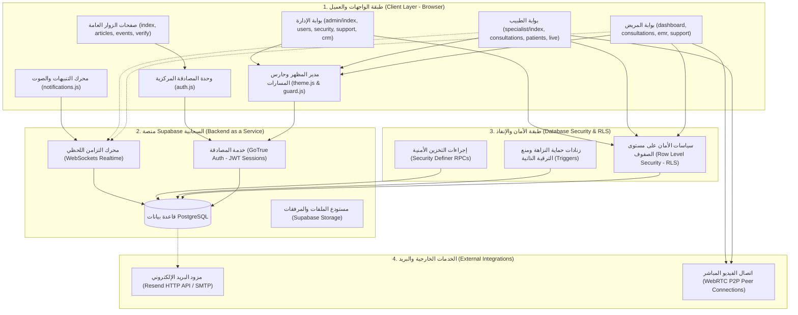

# بنية النظام والتدفق الشامل للبيانات (System Architecture & Data Flow)
## استوديو صحة الشباب | Youth Health Studio Telemedicine Platform
**تاريخ التوثيق:** 15 أكتوبر 2026  
**المعمارية التقنية:** Client-Centric Decoupled SPA Architecture with Supabase BaaS Engine

---

## 1. المخطط المعماري الشامل للنظام (System Architecture Diagram)

---

## 2. التدفق التشغيلي الشامل من البداية إلى النهاية (End-to-End Operational Lifecycle)

### الخطوة 1: وصول المستخدم وتحميل الواجهة
- يفتح المستخدم الموقع في المتصفح. يتم تحميل ملف HTML المتجاوب مع CSS واستيراد مكتبة Supabase JS عبر شبكة CDN.
- يقوم [js/theme.js](file:///c:/Users/abdelilah/Desktop/studio%20project/js/theme.js) بضبط المظهر الفاتح أو المظلم بناءً على تفضيل المستخدم المحفوظ في `localStorage`.
- يقوم [js/seo_injector.js](file:///c:/Users/abdelilah/Desktop/studio%20project/js/seo_injector.js) بحقن وسوم Open Graph والعناوين الوصفية ديناميكياً.

### الخطوة 2: فحص الجلسة وحارس المسارات (Session & Route Guard)
- في كل صفحة محمية، يستدعي [js/guard.js](file:///c:/Users/abdelilah/Desktop/studio%20project/js/guard.js) دالة `supabase.auth.getSession()`:
  - **إذا لم تكن هناك جلسة نشطة:** يتم تسجيل محاولة الوصول غير المصرح به وإعادة توجيه الزائر فوراً إلى `/login.html`.
  - **إذا كانت الجلسة نشطة:** يتم استرجاع سجل `profiles` الخاص بالمستخدم، والتحقق من صلاحية دوره:
    - محاولة دخول غير مصرح بها لبوابة الإدارة أو الأطباء -> التوجيه إلى `/unauthorized.html`.
    - دخول طبيب لبوابة المستخدم العادي -> إعادة التوجيه إلى `/specialist/index.html`.
    - صلاحية صحيحة ومطابقة -> السماح بتحميل المحتوى وحقن القوائم.

### الخطوة 3: التوجيه بعد تسجيل الدخول (Dashboard Redirection Matrix)
- عند نجاح `signIn(email, password)` في [js/auth.js](file:///c:/Users/abdelilah/Desktop/studio%20project/js/auth.js):
  - الأدوار `admin` أو `super_admin` -> التوجيه إلى `/admin/index.html`.
  - الأدوار `specialist` أو `doctor` -> التوجيه إلى `/specialist/index.html`.
  - الأدوار `user` أو `volunteer` -> التوجيه إلى `/dashboard.html`.

### الخطوة 4: التفاعل مع البيانات وأمان RLS
- جميع الاستعلامات الصادرة من المتصفح تمر بمفتاح `anon key` المصحوب برمز الجلسة المشفر (JWT Bearer Token):
  - يتم استخلاص `auth.uid()` تلقائياً في خادم PostgreSQL.
  - تطبق سياسات RLS لعزل البيانات: يرى المريض استشاراته ومواعيده وتذاكره فقط، ويرى الطبيب المرضى والاستشارات المخصصة له فقط، بينما يمتلك المشرفون صلاحيات التدقيق الإداري.
  - الملاحظات الإدارية الداخلية في تذاكر الدعم (`is_internal = true`) والملاحظات السريرية الخاصة في السجلات الطبية (`is_private = true`) يتم حجبها تماماً على مستوى المحرك (Zero Data Leakage).

### الخطوة 5: التزامن اللحظي وجلسات الكشف الطبي (Realtime & WebRTC)
- الاستشارات والمحادثات المباشرة تستخدم اشتراكات Supabase Realtime Channels للاستماع للرسائل الفورية في جدول `chat_messages`.
- جلسات الفيديو والصوت في [user_live_session.html](file:///c:/Users/abdelilah/Desktop/studio%20project/user_live_session.html) و [specialist/live_session.html](file:///c:/Users/abdelilah/Desktop/studio%20project/specialist/live_session.html) تستخدم بروتوكول WebRTC المباشر (Peer-to-Peer) مع تشفير نقطي كامل للصوت والصورة لحماية الخصوصية السريرية.

### الخطوة 6: نظام الإشعارات والبريد الإلكتروني
- المحرك المركزي [js/notifications.js](file:///c:/Users/abdelilah/Desktop/studio%20project/js/notifications.js) ينشئ إشعارات تفاعلية في جدول `notifications` مع منع التكرار خلال نافذة 5 دقائق وتوليد رنة صوتية ناعمة عبر Web Audio API.
- خدمة البريد [services/email_service.js](file:///c:/Users/abdelilah/Desktop/studio%20project/services/email_service.js) ترسل رسائل إشعار عربية منسقة (RTL) لحالات الاستشارات والمواعيد وتذاكر الدعم مع تصفية وتعقيم الكلمات الطبية لمنع تسرب أي تشخيص عبر البريد.
