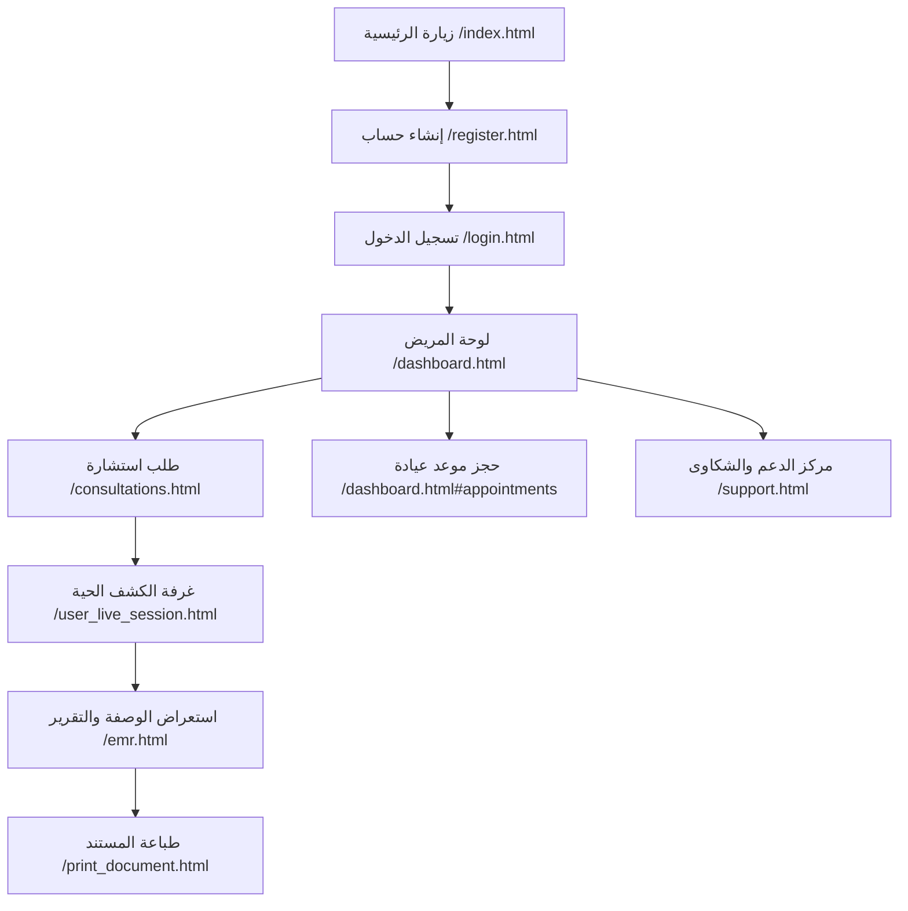
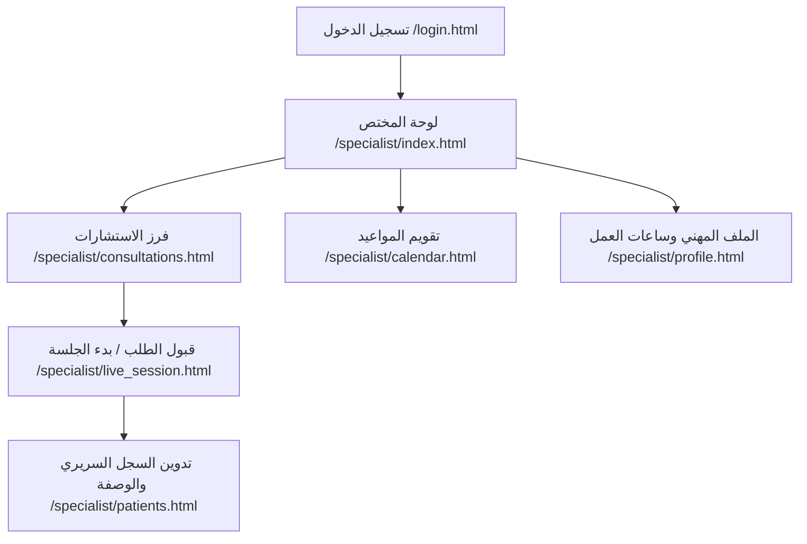
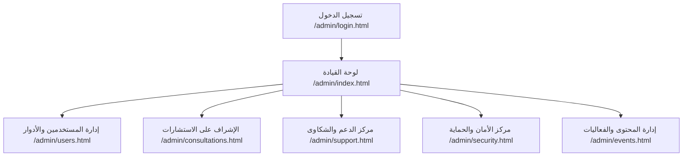

# رحلات وسيناريوهات المستخدمين التفاعلية (User Journeys & Workflows)
## استوديو صحة الشباب | Youth Health Studio Telemedicine Platform
**تاريخ التوثيق:** 15 أكتوبر 2026  
**الهدف:** توثيق المسارات السريرية والإدارية الفعلية التي يسلكها كل دور داخل المنصة، والروابط والأزرار التي تربط بين الخطوات.

---

## 1. رحلة المريض / المستخدم العادي (Patient / User Journey)

### الخطوات التفصيلية:
1. **التسجيل والمصادقة:**
   - **المسار:** [/register.html](file:///c:/Users/abdelilah/Desktop/studio%20project/register.html)
   - **الإجراء:** إدخال الاسم، البريد، كلمة المرور -> الضغط على `إنشاء الحساب`.
   - **التحقق:** إنشاء سجل في `auth.users` وزناد تلقائي ينشئ ملف `profiles` بدور `user`.
2. **تسجيل الدخول والتوجيه:**
   - **المسار:** [/login.html](file:///c:/Users/abdelilah/Desktop/studio%20project/login.html)
   - **الإجراء:** إدخال البريد وكلمة المرور -> استدعاء `signIn()` في [js/auth.js](file:///c:/Users/abdelilah/Desktop/studio%20project/js/auth.js).
   - **النتيجة:** التوجيه الآلي للوحة التحكم [/dashboard.html](file:///c:/Users/abdelilah/Desktop/studio%20project/dashboard.html).
3. **لوحة التحكم واستعراض الخدمات:**
   - **المسار:** [/dashboard.html](file:///c:/Users/abdelilah/Desktop/studio%20project/dashboard.html)
   - **الإجراء:** استعراض بطاقات الإحصاءات الصحية، جرس الإشعارات اللحظية، جدول المواعيد القادمة، والأزرار السريعة:
     - زر `➕ طلب استشارة جديدة` -> ينقل إلى [/consultations.html](file:///c:/Users/abdelilah/Desktop/studio%20project/consultations.html).
     - زر `📋 سجلي الطبي (EMR)` -> ينقل إلى [/emr.html](file:///c:/Users/abdelilah/Desktop/studio%20project/emr.html).
4. **طلب استشارة طبية عن بعد:**
   - **المسار:** [/consultations.html](file:///c:/Users/abdelilah/Desktop/studio%20project/consultations.html)
   - **الإجراء:** اختيار التخصص الطبي، تحديد درجة الأولوية، شرح الحالة الصحية، وإرفاق ملف توضيحي اختياري -> الضغط على `إرسال طلب الاستشارة الآن`.
   - **النتيجة:** تسجيل الطلب بحالة `pending` في جدول `consultations` وإشعار الأطباء والإدارة فورياً.
5. **الجلسة السريرية الافتراضية:**
   - **المسار:** [/user_live_session.html](file:///c:/Users/abdelilah/Desktop/studio%20project/user_live_session.html)`?id={consultation_id}`
   - **الإجراء:** بعد قبول الطبيب للطلب، يدخل المريض قاعة الفيديو الآمنة (WebRTC) مع محادثة نصية مباشرة وإرسال رسائل في جدول `chat_messages`.
6. **متابعة السجل الطبي والوصفات:**
   - **المسار:** [/emr.html](file:///c:/Users/abdelilah/Desktop/studio%20project/emr.html)
   - **الإجراء:** استعراض التشخيصات المعتمدة والوصفات الصادرة من الطبيب. الضغط على `طباعة التقرير` أو `تحميل الوصفة`.
   - **المسار الملحق:** [/print_document.html](file:///c:/Users/abdelilah/Desktop/studio%20project/print_document.html)`?type=prescription&id={id}`
   - **النتيجة:** عرض الوصفة الطبية بختم رقمي رسمي ورمز QR يتيح التحقق الفوري في [/verify.html](file:///c:/Users/abdelilah/Desktop/studio%20project/verify.html).
7. **الدعم الفني والشكاوى:**
   - **المسار:** [/support.html](file:///c:/Users/abdelilah/Desktop/studio%20project/support.html)
   - **الإجراء:** فتح تذكرة دعم، اختيار التصنيف من بين 6 تصنيفات، تلقي ردود الدعم الفني، والرد في المحادثة أو إغلاق التذكرة فور حلها.

---

## 2. رحلة الطبيب / المختص السريري (Doctor / Specialist Journey)

### الخطوات التفصيلية:
1. **المصادقة والتوجيه السريري:**
   - **المسار:** [/login.html](file:///c:/Users/abdelilah/Desktop/studio%20project/login.html)
   - **الإجراء:** إدخال البريد وكلمة المرور الخاصة بالطبيب.
   - **النتيجة:** يتعرف النظام على الدور `specialist` ويوجه الطبيب مباشرة إلى [/specialist/index.html](file:///c:/Users/abdelilah/Desktop/studio%20project/specialist/index.html).
2. **لوحة التحكم السريرية المركزية:**
   - **المسار:** [/specialist/index.html](file:///c:/Users/abdelilah/Desktop/studio%20project/specialist/index.html)
   - **الإجراء:** مراجعة بطاقات الأداء السريري (الاستشارات الجديدة، المواعيد المجدولة لليوم، تقييمات المرضى).
3. **فرز وقبول الاستشارات الطبية:**
   - **المسار:** [/specialist/consultations.html](file:///c:/Users/abdelilah/Desktop/studio%20project/specialist/consultations.html)
   - **الإجراء:** استعراض طلبات الاستشارة المعلقة `pending`، قراءة وصف المريض، ثم الضغط على `قبول الاستشارة` أو `بدء الجلسة الفورية`.
   - **النتيجة:** تحديث حالة الاستشارة إلى `accepted` أو `in_progress` وتعيين `specialist_id` بهوية الطبيب، وتوليد إشعار تلقائي للمريض.
4. **إدارة الجلسة الطبية الحية (Live Clinical Session):**
   - **المسار:** [/specialist/live_session.html](file:///c:/Users/abdelilah/Desktop/studio%20project/specialist/live_session.html)`?id={consultation_id}`
   - **الإجراء:**
     - فتح الكاميرا والميكروفون وإجراء الكشف الطبي المرئي عبر WebRTC.
     - كتابة ملاحظات الكشف في اللوحة الجانبية الفورية.
     - الضغط على `إنهاء الجلسة وإصدار التقرير` لنقل الحالة إلى `completed`.
5. **تدوين السجل الطبي وإصدار الوصفات:**
   - **المسار:** [/specialist/patients.html](file:///c:/Users/abdelilah/Desktop/studio%20project/specialist/patients.html)
   - **الإجراء:** فتح ملف المريض، مراجعة الحساسيات وفصيلة الدم، إضافة تدوين سريري في `case_notes`، وإدخال الأدوية والجرعات (Medications JSONB) مع التوقيع الرقمي للطبيب.
6. **إدارة التقويم والمواعيد السريرية:**
   - **المسار:** [/specialist/calendar.html](file:///c:/Users/abdelilah/Desktop/studio%20project/specialist/calendar.html)
   - **الإجراء:** مراجعة حجوزات المرضى، تأكيد الجلسات، أو إعادة الجدولة، وتحديد فترات التواجد السريري المتاحة.

---

## 3. رحلة المدير ومسؤول النظام (Admin & Super Admin Journey)

### الخطوات التفصيلية:
1. **المصادقة الإدارية المحمية:**
   - **المسار:** [/admin/login.html](file:///c:/Users/abdelilah/Desktop/studio%20project/admin/login.html) أو [/login.html](file:///c:/Users/abdelilah/Desktop/studio%20project/login.html)
   - **الإجراء:** التحقق من وجود دور `admin` أو `super_admin` في جدول `profiles`.
   - **النتيجة:** التوجيه إلى [/admin/index.html](file:///c:/Users/abdelilah/Desktop/studio%20project/admin/index.html) مع حقن الشريط الجانبي والترويسة الموحدة عبر [js/admin_components.js](file:///c:/Users/abdelilah/Desktop/studio%20project/js/admin_components.js).
2. **مركز القيادة والتحليلات:**
   - **المسار:** [/admin/index.html](file:///c:/Users/abdelilah/Desktop/studio%20project/admin/index.html)
   - **الإجراء:** استعراض مؤشرات الأداء الحقيقية، معدلات نمو الاستشارات، الرسوم البيانية التفاعلية، وتصدير التقارير الإدارية.
3. **إدارة الحسابات والصلاحيات (RBAC):**
   - **المسار:** [/admin/users.html](file:///c:/Users/abdelilah/Desktop/studio%20project/admin/users.html)
   - **الإجراء:**
     - البحث الحي بالاسم أو البريد الإلكتروني أو الولاية.
     - تعديل دور المستخدم (ترقية لطبيب أو متطوع أو مدير).
     - تغيير حالة الحساب (نشط، موقوف مؤقتاً، محظور).
     - تصدير سجلات المستخدمين إلى ملف CSV بترميز UTF-8 مع BOM.
     - *حماية أمنية:* منع المسؤول من تعديل رتبته بنفسه أو حظر نفسه لمنع الإغلاق العرضي.
4. **الإشراف على الاستشارات والمواعيد:**
   - **المسارات:** [/admin/consultations.html](file:///c:/Users/abdelilah/Desktop/studio%20project/admin/consultations.html) و [/admin/appointments.html](file:///c:/Users/abdelilah/Desktop/studio%20project/admin/appointments.html)
   - **الإجراء:** تعيين استشارة معلقة لطبيب محدد يدوياً، متابعة زمن الاستجابة، وحل أي تعارض في المواعيد.
5. **معالجة تذاكر الدعم والشكاوى:**
   - **المسار:** [/admin/support.html](file:///c:/Users/abdelilah/Desktop/studio%20project/admin/support.html)
   - **الإجراء:**
     - استعراض التذاكر المفتوحة.
     - استخدام المحرر المزدوج: إرسال رد رسمي للمريض (يحدث الحالة إلى `waiting_user` وينبه المريض)، أو إضافة ملاحظة إدارية سرية (`is_internal = true`) لا يراها المريض نهائياً.
6. **مراقبة الأمان وسجلات التدقيق:**
   - **المسار:** [/admin/security.html](file:///c:/Users/abdelilah/Desktop/studio%20project/admin/security.html)
   - **الإجراء:** مراجعة سجلات التدقيق الصارمة `audit_logs`، رصد محاولات الدخول الفاشلة، وتأمين النظام.

---

## 4. رحلة المتطوع (Volunteer Journey)

- **المسار الرئيسي:** [/dashboard.html](file:///c:/Users/abdelilah/Desktop/studio%20project/dashboard.html)
- **الإجراء:** يمتلك المتطوع شارة `متطوع (Volunteer)` في ملفه الشخصي، ويشارك في تنظيم الفعاليات الوطنية والأنشطة التوعوية عبر [/events.html](file:///c:/Users/abdelilah/Desktop/studio%20project/events.html) مع منعه تماماً من الوصول للوحات السريرية أو السجلات الطبية لمرضى آخرين بموجب حارس المسارات وسياسات RLS.
